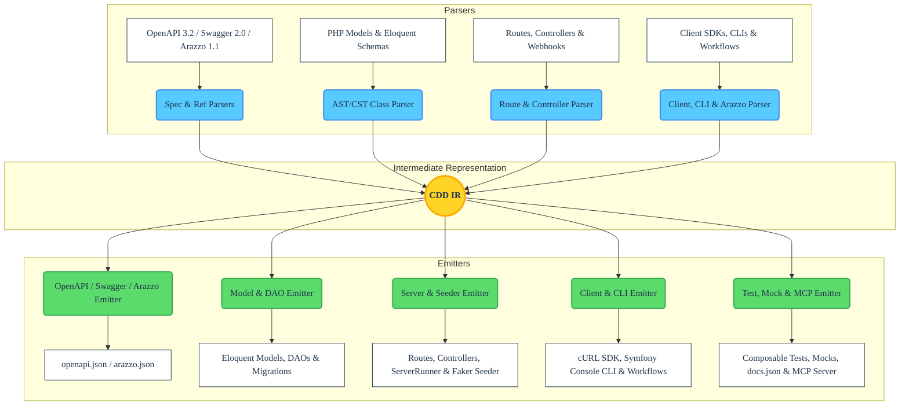

# cdd-php Architecture

<!-- BADGES_START -->

<!-- BADGES_END -->

The **cdd-php** toolchain is a standalone, bidirectional compiler and transpiler written in PHP 8.2+. Its architecture is divided into three distinct phases: **Frontend (Static AST/CST & Spec Parsing)**, **Intermediate Representation (IR)**, and **Backend (Format-Preserving Code & Spec Emission)**.

This decoupled design ensures that any supported input (OpenAPI 3.2.0, Swagger 2.0, Arazzo 1.1.0, MCP tool definitions, or PHP source code) parsed into the IR can be emitted or synchronized losslessly across servers, client SDKs, CLIs, database ORMs, workflow engines, tests, mocks, and specifications.

## High-Level Overview

## Core Components

### 1. The Frontend (`src/*/parse.php`)

The Frontend reads source specifications or PHP files and translates them into the normalized CDD Intermediate Representation:

* **Static AST/CST Analysis (`nikic/php-parser`)**: `cdd-php` never executes or `eval()`s user PHP files. It parses PHP source code into a syntax tree with token and comment trivia attached (`PhpParser\NodeVisitor\CloningVisitor`), extracting classes (`src/classes/`), Eloquent models (`src/components/`), routes (`src/routes/`), controllers (`src/controllers/`), cURL client calls (`src/client/`), Symfony Console commands (`src/cli/`), Arazzo workflows (`src/arazzo_client/`, `src/arazzo_cli/`, `src/arazzo_server/`), mocks (`src/mocks/`), and PHPDoc annotations (`src/docstrings/`).
* **OpenAPI, Swagger & Arazzo Parsing (`src/openapi/`, `src/arazzo/`)**: Validates and normalizes OpenAPI 3.0/3.1/3.2, upgrades Swagger 2.0 documents, resolves JSON Pointer `$ref`s (`src/openapi/resolve_refs.php`), and parses Arazzo 1.0.x/1.1.0 workflow graphs.

### 2. Intermediate Representation (IR)

The Intermediate Representation is a normalized associative AST/schema graph modeling:
* **Schemas & Models**: Typed properties, JSON Schema 2020-12 constraints, discriminators, XML metadata, and relational foreign keys.
* **Paths, Webhooks & Operations**: HTTP methods (including OpenAPI 3.2 `QUERY` and `additionalOperations`), parameters (`path`, `query`, `querystring`, `header`, `cookie`), request bodies, multipart encodings, responses, links, callbacks, and security requirements.
* **Workflows**: Arazzo `sourceDescriptions`, `workflows`, `steps`, runtime expressions, and success/failure actions.

### 3. The Backend (`src/*/emit.php`)

The Backend emits or patches target files from the IR:

* **Format-Preserving AST/CST Patching**: When updating existing PHP files (`src/classes/emit.php`), `nikic/php-parser`'s `Standard::printFormatPreserving()` surgically updates properties, methods, and PHPDoc blocks while preserving surrounding formatting, comments, and custom method implementations.
* **Multi-Tiered Server & ORM Generation**: Emits Eloquent models (`src/classes/`), DAO interfaces/stubs/concrete classes (`src/daos/`), `Illuminate\Database\Capsule\Manager` connections and schema migrations (`src/database/`), topologically sorted `FakerPHP/Faker` seeders (`src/seeder/`), `ServerRunner.php` (`src/server_cli/`), and a zero-config standalone server script (`src/standalone_server/`).
* **SDK, CLI, Workflow, MCP & Test Generation**: Emits `ApiClient.php` (`src/client/`), `api_cli.php` (`src/cli/`), `ApiWorkflows.php` / `arazzo_cli.php` / `WorkflowEngine.php` (`src/arazzo*/`), `mcp_server.php` (`src/openapi/mcp_schema.php`), and `ComposableTests.php` / `mocks.php` (`src/tests/`, `src/mocks/`).

## Design Principles

1. **A Single Source of Truth**: Maintain definitions in whichever representation is most ergonomic (`openapi.json`, `arazzo.json`, PHP classes, routes, or SDKs) and synchronize the rest via `cdd-php sync`.
2. **Zero-Execution Static Parsing**: Analyze PHP code strictly via `nikic/php-parser` AST/CST traversal and static expression evaluation (`\Cdd\Mocks\evaluateAstNode`).
3. **Lossless Conversion**: Preserve metadata, PHPDoc annotations, comments, and formatting across `Source -> IR -> Target` roundtrips.
4. **100% Test & Documentation Coverage**: Enforced continuously via `bin/check_coverage.php` (`phpdbg` oplog) and `bin/check_docs.php` (`nikic/php-parser`).
